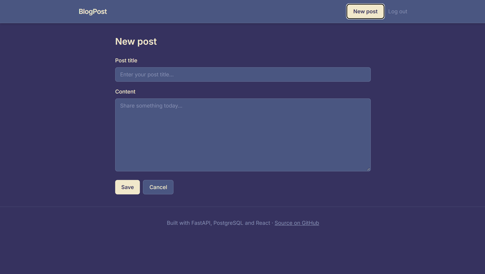

# BlogPost


A full-stack blogging app where users can sign up, write posts, vote and comment. The backend is a FastAPI REST API on PostgreSQL, and the frontend is a React + TypeScript single-page app.

**Live demo:** https://blogpost-7pyb.onrender.com · **API docs:** https://blog-post-bvdl.onrender.com/docs

> Hosted on free plans: the API sleeps when idle, so the first request can take up to a minute.

| Feed | Post with comments |
|---|---|
|  |  |

## Features

- **JWT authentication** with bcrypt password hashing
- **Posts:** create, edit and delete, with title search and pagination
- **Votes:** one vote per user per post; counts aggregated with SQL joins
- **Comments:** add and delete comments on any post; only the author can delete theirs
- **Ownership checks:** users can only edit or delete their own content
- **44 automated tests** with pytest against a real PostgreSQL database

## Tech stack

| Area | Tools |
|---|---|
| Backend | FastAPI, Pydantic, SQLAlchemy 2.0, Alembic, python-jose, Passlib |
| Database | PostgreSQL (Neon in production) |
| Frontend | React, TypeScript, Vite, React Router, Tailwind CSS |
| Testing | pytest, FastAPI TestClient |
| DevOps | Docker, Docker Compose, GitHub Actions, Render |

## Architecture

```
React app (Render static site) ──HTTPS + JWT──▶ FastAPI (Render, Docker) ──▶ PostgreSQL (Neon)
```

Every push and pull request runs the test suite in GitHub Actions against a temporary PostgreSQL database. Render deploys `main` only after CI passes, and Alembic migrations run automatically when the API container starts.

## Running locally

**Prerequisites:** Python 3.13+, [uv](https://docs.astral.sh/uv/), Node.js 22+, and PostgreSQL (or Docker).

### Backend

Create a `.env` file in the project root:

```dotenv
DATABASE_HOSTNAME=localhost
DATABASE_PORT=5432
DATABASE_USERNAME=postgres
DATABASE_PASSWORD=your_password
DATABASE_NAME=fastapi
SECRET_KEY=your_secure_secret
```

```bash
uv sync
uv run alembic upgrade head
uv run uvicorn app.main:app --reload    # http://localhost:8000/docs
```

Or run the API and PostgreSQL together with `docker compose up --build` (set `DATABASE_HOSTNAME=db`).

### Frontend

```bash
cd frontend
npm install
cp .env.example .env.local    # VITE_API_URL=http://localhost:8000
npm run dev                   # http://localhost:5173
```

### Tests

```bash
uv run pytest -v
# or in Docker:
docker compose -f compose.test.yaml run --build --rm tests
```

Tests need a database whose name ends in `_test`; they refuse to run against any other database.

## Configuration

| Variable | Purpose |
|---|---|
| `DATABASE_URL` | Full connection string (production). If unset, the `DATABASE_*` fields are used |
| `SECRET_KEY` | Signs JWTs |
| `ALGORITHM`, `ACCESS_TOKEN_EXPIRE_MINUTES` | JWT settings (defaults: `HS256`, `30`) |
| `CORS_ORIGINS` | Comma-separated frontend URLs allowed to call the API |
| `VITE_API_URL` | API address used by the frontend at build time |

## Beyond the tutorial

The core API (users, posts, votes, JWT auth) started from [this FastAPI course](https://youtu.be/0sOvCWFmrtA). I then added:

- Comments: model, Alembic migration, endpoints and tests
- A React + TypeScript frontend with a custom theme and an About page
- Production configuration: a single `DATABASE_URL`, CORS from environment variables, and migrations on startup
- A CI/CD pipeline with GitHub Actions, and deployment on Render with Neon PostgreSQL
- A fix so signing up with an existing email returns a clear 409 error instead of crashing